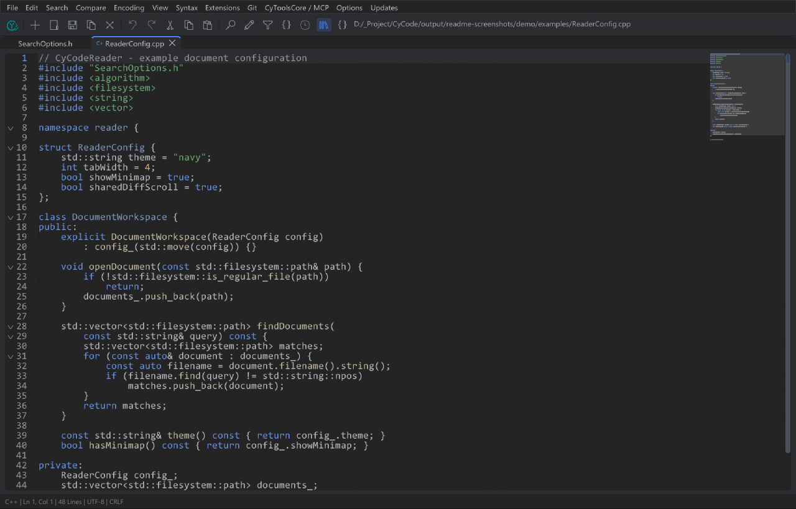
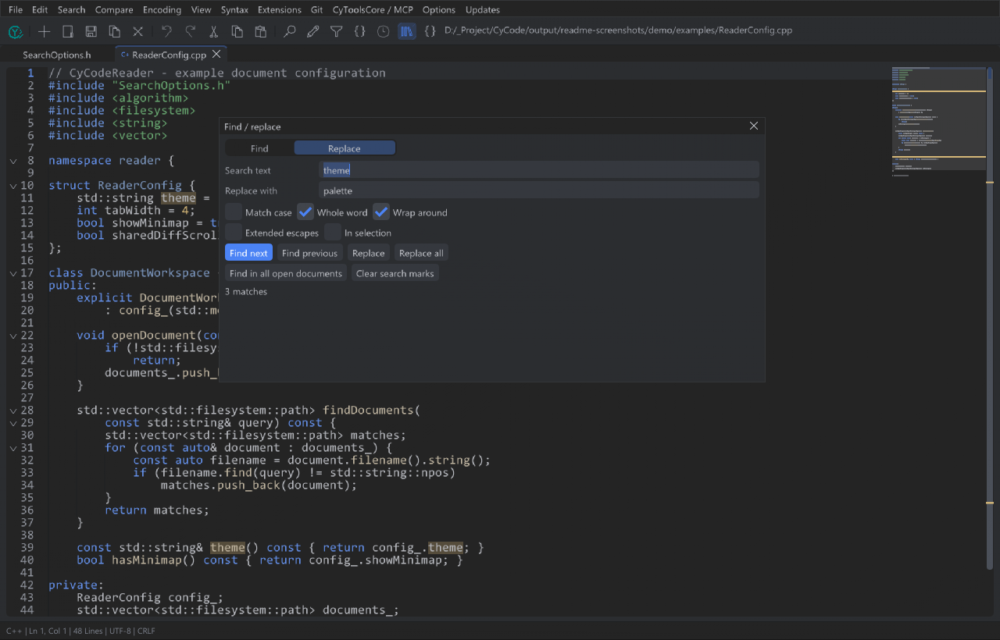
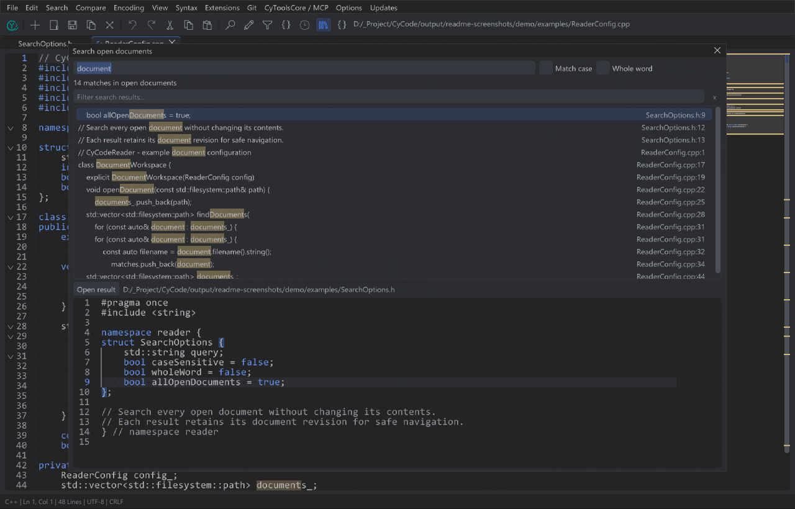
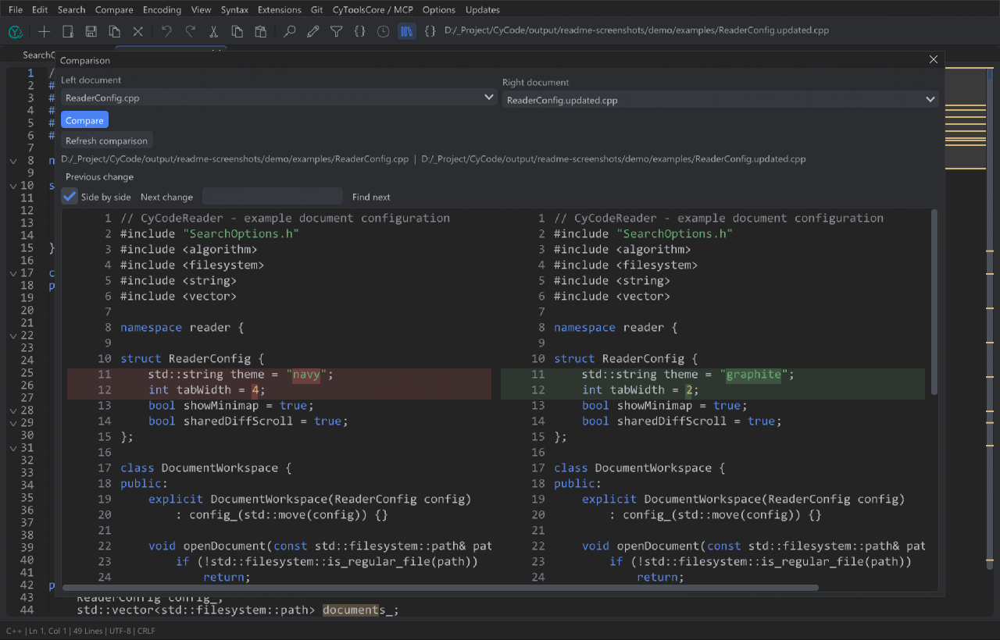
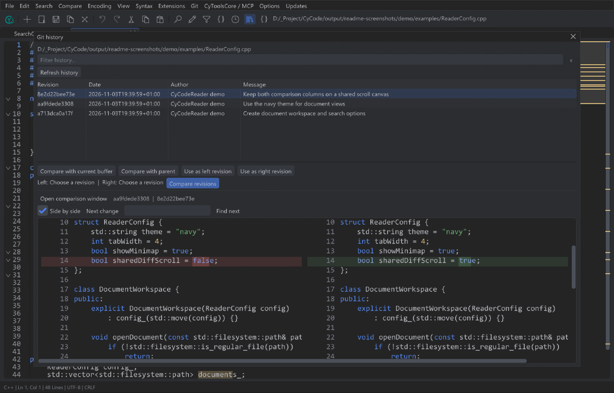

<table width="100%">
  <tr>
    <td width="300" align="left" valign="top">
      <a href="https://mrmybal.github.io/CyCodeReader/Documentation.html#/fr/overview">Documentation</a><br>
      <a href="https://github.com/MrMybal/CyCodeReader">GitHub</a><br><br>
      <sub>README</sub><br>
      <a href="README.md">English</a> · <a href="README.fr.md">Français</a>
    </td>
    <td width="400" align="center" valign="middle">
      <a href="https://mrmybal.github.io/CyCodeReader/Documentation.html#/fr/overview"></a><br>
      <strong>CyCodeReader</strong>
    </td>
    <td width="300" align="right" valign="top">
      <p><sub>Licence de l’application</sub><br><a href="LICENSE"><strong>GPL-3.0-only</strong></a></p>
      <p><sub>Version</sub><br><a href="VERSION.fr.md"><strong>0.1.3</strong></a><br><strong>BÊTA</strong></p>
      <p><a href="https://github.com/MrMybal/CyCodeReader/releases/download/v0.1.3/CyCodeReader-0.1.3-windows-x64-portable.zip"><strong>Télécharger CyCodeReader</strong></a><br><sub>Windows x64 · portable</sub></p>
    </td>
  </tr>
</table>

<h1 align="center">CyCodeReader</h1>

Un éditeur natif de code et de texte pour les développeurs qui veulent ouvrir
leurs fichiers directement, les modifier avec une coloration syntaxique, chercher
dans les documents et comparer des révisions. Construit avec CyUI, il fonctionne
indépendamment de l’IDE CyCode.

> **BÊTA · 0.1.3**
>
> Le développement se poursuit après la première bêta publique. La validation
> interactive et de l’installation reste en cours. La version 0.1.3 ajoute la
> syntaxe Verse et actualise le manuel CyDoc anglais/français. Consultez les
> [notes de version et limites connues](VERSION.fr.md).

[](Docs/images/editor.png)

*Vues réelles de l’application v0.1.1, rendues à partir des données ImGui sur des
documents d’exemple. Ces images illustrent l’interface ; elles ne valident pas
le fonctionnement sur le bureau ou l’installateur de la v0.1.3.*

## À propos de CyCodeReader

Ouvrez des fichiers depuis la ligne de commande, la boîte de sélection multiple
ou par glisser-déposer. Utilisez les onglets ancrables, déplacez un document dans
une véritable fenêtre native sur un autre écran ou lancez une autre instance
pour un ensemble de fichiers distinct. L’édition ne nécessite ni Python ni un
dépôt local de CyCode.

Recherchez et remplacez dans le document actif, ou cherchez dans tous les buffers
ouverts, y compris les documents sans nom et non enregistrés. Comparez des onglets,
un fichier disque ou la dernière sauvegarde sans modifier les sources. Le plugin
Git fourni ajoute l’historique des fichiers/sélections et les comparaisons avec
HEAD, l’index et d’autres révisions ; Git doit être installé dans PATH. Reader
ne fournit pas le parcours de commit/compilation/débogage de l’IDE.

| Recherche et remplacement | Recherche dans les documents ouverts |
| :---: | :---: |
| [](Docs/images/find-replace.png) | [](Docs/images/search-documents.png) |
| **Comparaison en lecture seule** | **Historique de fichier Git** |
| [](Docs/images/compare.png) | [](Docs/images/git-history.png) |

## Fonctionnalités

- **Édition** : annulation/rétablissement, curseurs multiples, repli du code,
  appariement des délimiteurs, indentation, extraits, minimap, retour à la ligne
  et espaces visibles ; six thèmes et interface anglais/français.
- **Syntaxes** : 102 modes CyUI partagés, dont C/C++/Unreal, C#, Rust, Java,
  JavaScript/TypeScript, HTML/CSS, Python, Lua, JSON, Markdown, HLSL, GLSL et Verse.
  Les journaux distinguent les lignes Error et Warning. La coloration fonctionne
  sans outils de langage ; complétion sémantique, compilation et intégration UEFN
  ne sont pas incluses.
- **Recherche et comparaison** : recherche/remplacement littéral, résultats avec
  aperçu dans les documents ouverts, différences côte à côte ou unifiées,
  navigation des changements et historique Git local.
- **Formats** : UTF-8/BOM, UTF-16 LE/BE BOM, Windows-1252 explicite et conversion
  LF/CRLF/CR. L’enregistrement reste explicite ; les écritures atomiques contrôlent
  les changements externes et refusent les conversions destructives. Les fichiers
  texte sont limités à 4 Mio.
- **Extensions** : manifestes et plugins natifs ABI 1 ajoutent commandes, options
  typées et syntaxes, dont des moteurs natifs et fournisseurs de comparaisons.
  Un redémarrage est nécessaire ; les plugins natifs sont du code de confiance
  exécuté dans le processus.
- **Automatisation et aide** : le SDK/MCP CyToolsCore optionnel accède aux mêmes
  documents actifs et contrôles de révision. F1 ouvre le manuel CyDoc illustré
  local. Le compagnon privé Python/SDK s’installe séparément.

La recherche est littérale, avec une comparaison de casse limitée à l’ASCII.
Recherche récursive dans un dossier, remplacement regex, macros, commandes externes
arbitraires, récupération après plantage, restauration complète de session/Undo
et place de marché de plugins restent indisponibles. Les plugins Reader ont leur
propre ABI ; les binaires Notepad++ et CyCode ne sont pas compatibles. Voir les
[capacités et limites](https://mrmybal.github.io/CyCodeReader/Documentation.html#/fr/limits).

| Raccourci | Action |
| --- | --- |
| Ctrl+N / Ctrl+O | Nouveau document / ouvrir des fichiers |
| Ctrl+S / Ctrl+Shift+S / Ctrl+Alt+S | Enregistrer / enregistrer sous / tout enregistrer |
| Ctrl+W / Ctrl+Tab | Fermer / document suivant |
| Ctrl+F / Ctrl+H / F3 / Shift+F3 | Rechercher / remplacer / résultat suivant / précédent |
| Ctrl+Shift+F | Rechercher dans tous les documents ouverts, même non enregistrés |
| Ctrl+G | Atteindre une ligne |
| Ctrl+P / Ctrl+Shift+P | Palette des fichiers ouverts / des actions |

Les menus et panneaux ont des filtres indépendants pour les noms, chemins,
extensions et options des plugins. Ctrl+F cible le filtre d’un panneau focalisé ;
dans l’éditeur, il conserve la recherche du document. Échap efface le filtre.
Voir le [guide clavier](https://mrmybal.github.io/CyCodeReader/Documentation.html#/fr/shortcuts).

---

## Installation

Les paquets publiés ciblent **Windows 10/11 x64**, avec un pilote **OpenGL 3.3**.
Les DLL du runtime MSVC sont fournies avec les paquets Windows. Linux et macOS
restent des cibles prévues depuis les sources ; leur fonctionnement graphique
complet n’est pas validé et cette version ne propose aucun paquet natif pour eux.

1. [Télécharger le ZIP portable](https://github.com/MrMybal/CyCodeReader/releases/download/v0.1.3/CyCodeReader-0.1.3-windows-x64-portable.zip) ou [l’installateur par utilisateur](https://github.com/MrMybal/CyCodeReader/releases/download/v0.1.3/CyCodeReader-0.1.3-windows-x64-setup.exe).
2. Extraire le ZIP **complet** dans un dossier accessible en écriture et lancer
   `CyCodeReader.exe`, avec tous les dossiers fournis à côté ; ou exécuter Setup
   pour l’utilisateur courant.
3. Ouvrir les fichiers et choisir une syntaxe si nécessaire. Installer Git
   séparément pour l’historique optionnel ; configurer le SDK privé uniquement
   pour utiliser MCP.

Les [notes de release et sommes SHA-256](https://github.com/MrMybal/CyCodeReader/releases/tag/v0.1.3)
accompagnent les deux téléchargements. Les réglages portables restent dans
`data/reader` ; les réglages installés utilisent `%LOCALAPPDATA%/CyCodeReader/reader`.
Les versions publiques vérifient GitHub Releases ; téléchargement et installation
nécessitent une action explicite. Voir [installation et mises à jour](https://mrmybal.github.io/CyCodeReader/Documentation.html#/fr/updates).

Ouvrir `Documentation/Documentation.html` avec son dossier `DocData/` complet pour
l’aide hors ligne, sans serveur, CDN ou réseau. Le [manuel en ligne](https://mrmybal.github.io/CyCodeReader/Documentation.html#/fr/overview)
utilise le même lecteur, avec navigation, recherche, images, schémas et les deux langues.

## Sources, compilation et bibliothèques nécessaires

<details>
<summary>Compiler CyCodeReader depuis les sources</summary>

Prérequis : Python 3.11+, Git, CMake 3.24+, compilateur C++20 et, pour la documentation,
Node.js 22+ avec npm. Windows utilise Visual Studio 2022 C++ ; les autres cibles
depuis les sources nécessitent Ninja, OpenGL et les bibliothèques de développement SDL3.

```sh
git clone https://github.com/MrMybal/CyCodeReader.git
cd CyCodeReader
python scripts/fetch_dependencies.py
python scripts/build.py
```

Le résolveur récupère la révision exacte de CyUI depuis son dépôt officiel.
L’option `--cyui PATH` doit sélectionner un dépôt propre à la même révision ;
aucun dépôt amont n’est réinitialisé. Les modules graphiques sont **Core, Code,
CodeEditor, Commands, Inspector, Diagnostics et Diff**, avec un seul moteur
ImGui/TextEditor. Audio, Gallery, CEF et les démonstrations sont désactivés.
CyDoc sélectionne séparément **image/gallery** pour le manuel.

La sortie Windows est `runtime/build-vs/Release` ; les autres compilations depuis
les sources utilisent `runtime/build`. Les compilations ordinaires désactivent
les tests natifs et ne lancent pas l’application. `--core-only` compile les services
de documents/extraits sans SDL/ImGui/CyUI ; il ne produit pas l’interface. L’édition
elle-même ne nécessite aucun runtime Python.

Le [guide de développement](Docs/Development.md) détaille les options de compilation,
l’intégration de l’éditeur partagé, les paquets et la configuration optionnelle du
wheel CyToolsCore verrouillé. La [génération documentaire](.CyDocBuild/README.md)
utilise la chaîne CyDoc existante. Ces guides techniques sont en anglais.

La [vitrine locale](website/README.md) se génère avec `python website/build.py`.
Prévisualisation : `python website/preview.py --port 4388`, puis ouvrir
`http://127.0.0.1:4388/?lang=fr`. Le dossier complet `dist/website/` contient
la présentation et son véritable manuel HTML hors ligne.

</details>

---

## Licence

**CyCodeReader, sa bibliothèque originale `editor/`, sa documentation et ses
exemples utilisent la [GNU GPL v3 uniquement](LICENSE) (`GPL-3.0-only`).**
Copyright © 2026 Cyberalien ; voir [COPYRIGHT](COPYRIGHT). Les composants tiers
conservent leurs propres conditions.

### Bibliothèques tierces

| Bibliothèque · sources | Licence · texte | Utilisation / périmètre |
| --- | --- | --- |
| [CyUI](https://github.com/MrMybal/CyUI) | [MIT](licenses/CyUI.txt) | Interface native modulaire, éditeur de code, commandes filtrables, diagnostics et comparaisons. |
| [Dear ImGui](https://github.com/ocornut/imgui) · [TextEditor](https://github.com/goossens/ImGuiColorTextEdit) | [MIT](licenses/DearImGui.txt) · [MIT](licenses/TextEditor.txt) | Widgets natifs et moteur d’édition unique fourni par CyUI. |
| [SDL3](https://github.com/libsdl-org/SDL) | [zlib](licenses/SDL3.txt) | Fenêtres natives, saisie et intégration du rendu. |
| [nlohmann/json](https://github.com/nlohmann/json) | [MIT](licenses/nlohmann-json.txt) | Modèles JSON natifs, manifestes des plugins et messages du pont. |
| [Tree-sitter](https://github.com/tree-sitter/tree-sitter) | [MIT](licenses/tree-sitter.txt) | Analyse incrémentale dans l’éditeur partagé. |
| [Grammaires Tree-sitter](https://github.com/tree-sitter) | [Rust](licenses/tree-sitter-rust.txt), [Java](licenses/tree-sitter-java.txt), [JavaScript](licenses/tree-sitter-javascript.txt), [TypeScript](licenses/tree-sitter-typescript.txt), [HTML](licenses/tree-sitter-html.txt), [CSS](licenses/tree-sitter-css.txt) · MIT | Analyseurs de langages ; conserver la notice de chaque grammaire. |
| [Lexilla / Scintilla](https://github.com/ScintillaOrg/lexilla) · [SciTE](https://www.scintilla.org/SciTE.html) | [Lexilla](licenses/Lexilla.txt), [Scintilla](licenses/Scintilla.txt), [SciTE](licenses/SciTE-Properties.txt) | Notices permissives des lexers, en-têtes publics et mots-clés ; aucun éditeur Scintilla ou plugin binaire Notepad++ n’est lié. |
| CyToolsCore SDK 0.10.1 — distribution privée | [MIT](licenses/CyToolsCore.txt) | Compagnon SDK/MCP optionnel, fourni séparément par le wheel verrouillé du propriétaire. |
| [MCP Python SDK](https://github.com/modelcontextprotocol/python-sdk) | [MIT](licenses/MCP-Python.txt) | Transport MCP officiel dans l’environnement Python optionnel. |
| [CyDoc](https://github.com/MrMybal/CyDoc) | [MIT](https://github.com/MrMybal/CyDoc/blob/6ddf9a582defb2f11fbb3f992afef6f98dcadc93/LICENSE) | Lecteur hors ligne embarqué avec les modules image/gallery, sans runtime Three.js. |
| [marked](https://github.com/markedjs/marked) | [MIT](https://github.com/markedjs/marked/blob/v17.0.1/LICENSE.md) | Compilation du Markdown lors de la génération. |
| [PrismJS](https://github.com/PrismJS/prism) | [MIT](https://github.com/PrismJS/prism/blob/v1.30.0/LICENSE) | Coloration de la documentation lors de la génération. |
| [esbuild](https://github.com/evanw/esbuild) | [MIT](https://github.com/evanw/esbuild/blob/v0.25.12/LICENSE.md) | Assemblage de la documentation lors de la génération. |

Les révisions et empreintes sont dans [dependencies.lock.json](dependencies.lock.json),
[le verrou CyUI](editor/cyui-source.lock.json) et [le verrou CyDoc](.CyDocBuild/cydoc.lock.json).
Les [notices tierces](THIRD_PARTY_NOTICES.md) et le dossier `licenses/` restent
nécessaires ; ce tableau ne remplace pas les textes complets. Les notices CyDoc,
marked, PrismJS et esbuild sont aussi livrées dans `Documentation/DocData/licenses/`.
Les destinataires des binaires doivent pouvoir obtenir les sources correspondantes
exactes et leurs dépendances verrouillées ; cette notice n’accorde pas automatiquement
l’accès à une dépendance privée.

## Références et liens

- [Documentation française](https://mrmybal.github.io/CyCodeReader/Documentation.html#/fr/overview) · [English documentation](https://mrmybal.github.io/CyCodeReader/Documentation.html#/en/overview).
- [Notes de version](VERSION.fr.md) · [Téléchargements](https://github.com/MrMybal/CyCodeReader/releases).
- [Dépôt des sources](https://github.com/MrMybal/CyCodeReader) · [Suivi des problèmes](https://github.com/MrMybal/CyCodeReader/issues).
- [CyCode](https://github.com/MrMybal/CyCode) — l’IDE indépendant qui consomme la même bibliothèque source `editor/`.

<details>
<summary><strong>AI Usage</strong></summary>

- [Commencer ici : instructions du projet](AGENTS.md) — responsabilités, dépendances et règles de plateforme.
- [Compilation et intégration de l’éditeur partagé](Docs/Development.md) · [Architecture](Docs/Architecture.md).
- [Plugins Reader](Docs/Plugins.md) · [Fournisseurs de comparaisons](Docs/Comparison.md) · [Contrats SDK/MCP](Docs/MCP.md).
- [Chaîne documentaire](.CyDocBuild/README.md) — générer et distribuer le lecteur hors ligne complet.

Ces références techniques sont en anglais.

</details>
