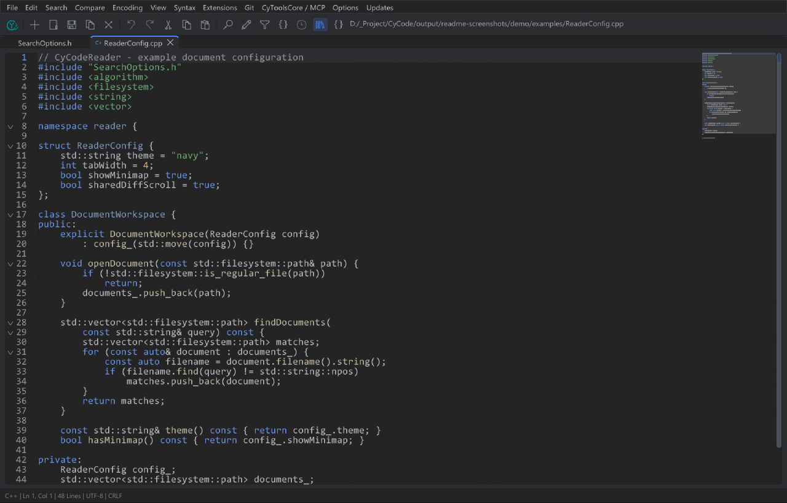
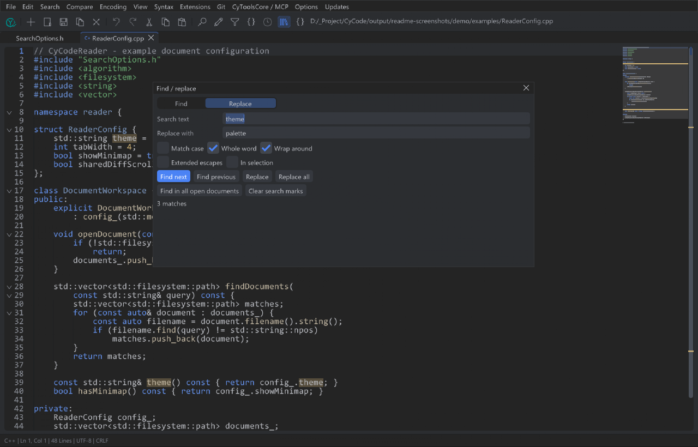
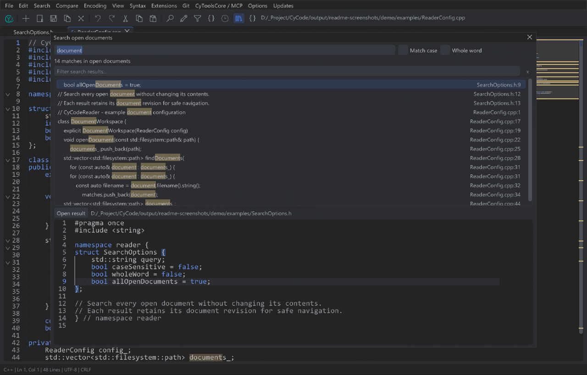
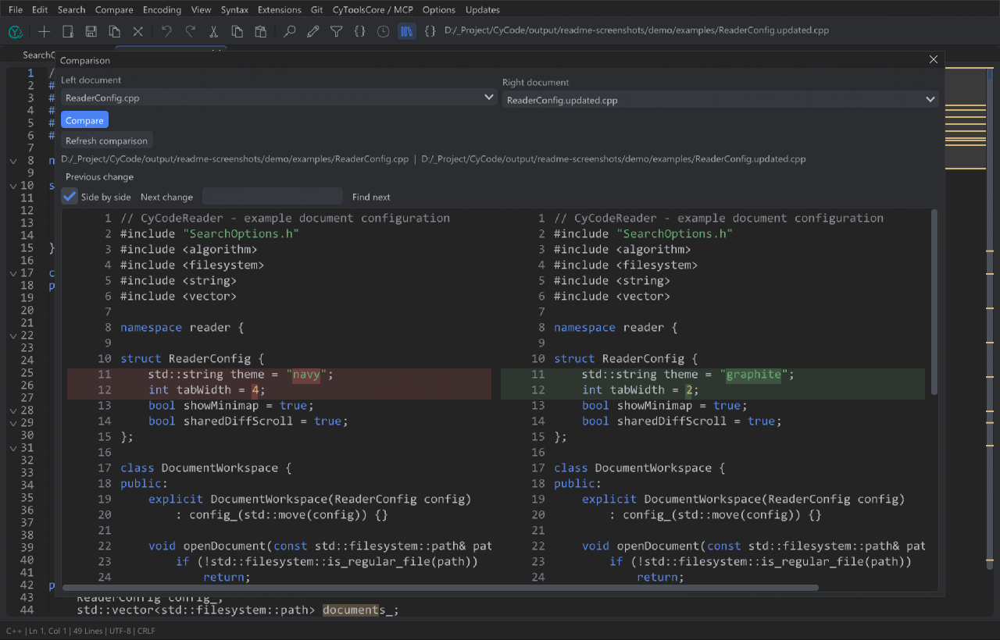
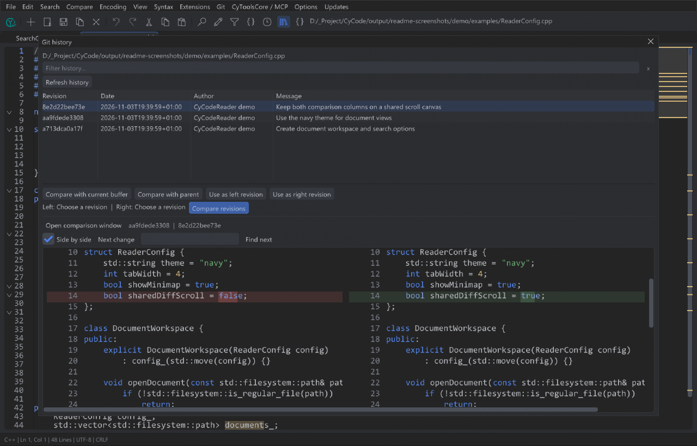

<table width="100%">
  <tr>
    <td width="300" align="left" valign="top">
      <a href="https://mrmybal.github.io/CyCodeReader/">Website</a><br>
      <a href="https://mrmybal.github.io/CyCodeReader/Documentation.html#/en/overview">Documentation</a><br>
      <a href="https://github.com/MrMybal/CyCodeReader">GitHub</a><br><br>
      <sub>README</sub><br>
      <a href="README.md">English</a> · <a href="README.fr.md">Français</a>
    </td>
    <td width="400" align="center" valign="middle">
      <a href="https://mrmybal.github.io/CyCodeReader/"></a><br>
      <strong>CyCodeReader</strong>
    </td>
    <td width="300" align="right" valign="top">
      <p><sub>Application license</sub><br><a href="LICENSE"><strong>GPL-3.0-only</strong></a></p>
      <p><sub>Version</sub><br><a href="Docs/Releases/v0.1.7.md"><strong>0.1.7</strong></a><br><strong>BETA</strong></p>
      <p><a href="https://github.com/MrMybal/CyCodeReader/releases/download/v0.1.7/CyCodeReader-0.1.7-windows-x64-setup.exe"><strong>Install CyCodeReader</strong></a><br><sub>Windows x64 · installer</sub><br><a href="https://github.com/MrMybal/CyCodeReader/releases/download/v0.1.7/CyCodeReader-0.1.7-windows-x64-portable.zip">Portable ZIP</a></p>
    </td>
  </tr>
</table>

<h1 align="center">CyCodeReader</h1>

A native code and text editor for developers who want to open files directly,
edit with syntax highlighting, search live documents and compare revisions.
Built with CyUI, it runs independently of the CyCode IDE.

> **BETA · 0.1.7**
>
> Version 0.1.7 adds shared native Core services and paged editing for large
> UTF-8 files, retaining the 0.1.6 Windows updater fix, JetBrains Mono, zoom and
> code colours. Paged mode has explicit feature/recovery limits. Desktop and
> installer acceptance remain unverified. Read the [release notes](Docs/Releases/v0.1.7.md).
> If 0.1.4 or 0.1.5 reports **Invalid update arguments**, close Reader and run the
> current installer manually once; see the [recovery guide](Docs/Releases/v0.1.6.md).

[](Docs/images/editor.png)

*Actual v0.1.1 application views rendered from ImGui draw data on sample documents.
The screenshots illustrate the interface; they do not establish desktop or
installer acceptance for v0.1.7, and predate its new code font and palette.*

## About CyCodeReader

Open files from the command line, the multi-file dialog or drag and drop. Work
with dockable tabs, move a document into a real native window on another display,
or launch another instance for a separate set of files. Python and a CyCode
checkout are not needed to edit text.

Search and replace in the active document or search every open buffer, including
untitled and unsaved text. Compare live tabs, a disk file or a saved baseline
without modifying either source. The bundled Git plugin adds file/selection
history and comparisons with HEAD, the index and other revisions; Git must be
installed in PATH. Reader does not provide the IDE's commit/build/debug workflow.

| Find and replace | Search open documents |
| :---: | :---: |
| [](Docs/images/find-replace.png) | [](Docs/images/search-documents.png) |
| **Read-only comparison** | **Git file history** |
| [](Docs/images/compare.png) | [](Docs/images/git-history.png) |

## Current sources (unreleased)

Working sources now pin Core `0541cd0c438bcca507da232e9e1caa2156596910` with native/common
source API 1 and retain CyUI `0ba1ba663b4b2bf46d066a32829bc91ea2743cba`.
The local document-word suggestions, block indentation and selected-identifier
occurrence corrections are preserved. Public 0.1.7 downloads remain unchanged;
their original dependency pair is recorded below. See [validation](Docs/Validation.md).

## Shared native Core in 0.1.7

Version 0.1.7 pins Core `f5e6261bf8acf22d0b3241622ed4294322724fb9`
and CyUI `0ba1ba663b4b2bf46d066a32829bc91ea2743cba`. A shared native
paged editor opens large UTF-8 files with asynchronous pages, Undo/Redo, search
and complete streamed saves. See the [0.1.7 notes](Docs/Releases/v0.1.7.md) and
[architecture, budgets and missing common contracts](Docs/PagedText.md).

## Features

- **Editing:** Undo/Redo, multiple cursors, folding, bracket matching, indentation,
  snippets, minimap, wrapping and whitespace controls; six themes and EN/FR UI.
- **Code readability:** bundled JetBrains Mono under SIL OFL 1.1; Ctrl + mouse
  wheel scales the hovered code view from 50 to 300%, including previews and diffs.
  Orange strings, green comments and vertical guides limited to code blocks.
- **Syntax:** 102 shared CyUI modes, including C/C++/Unreal, C#, Rust, Java,
  JavaScript/TypeScript, HTML/CSS, Python, Lua, JSON, Markdown, HLSL, GLSL and Verse.
  Log syntax distinguishes Error and Warning lines. Syntax works without language
  toolchains; semantic completion, compilation and UEFN integration are not included.
- **Find and compare:** literal find/replace, open-document results with previews,
  split/unified diffs, change navigation and local Git history.
- **File formats:** UTF-8/BOM, UTF-16 LE/BE BOM, explicit Windows-1252 and LF/CRLF/CR
  conversion. Saving is explicit; guarded atomic writes check external changes
  and refuse lossy encoding conversions. Ordinary documents are limited to 4 MiB; larger UTF-8 uses the paged profile.
- **Extensions:** manifests and native ABI 1 plugins contribute commands, typed
  options and syntax, including native syntax engines and comparison providers.
  Restart is required; native plugins run as trusted code in the process.
- **Automation and help:** optional CyToolsCore SDK/MCP accesses the same live
  ordinary documents and revision guards; paged bridge support is pending. F1 opens the local illustrated CyDoc manual.
  The private Python/SDK companion is installed separately.

Search is literal with ASCII case folding. Recursive folder search, regex
replacement, macros, arbitrary external run commands, crash recovery, complete
session/Undo restoration and a plugin marketplace remain unavailable. Reader
plugins use their own ABI; Notepad++ and CyCode plugin binaries are not compatible.
See [capabilities and limits](https://mrmybal.github.io/CyCodeReader/Documentation.html#/en/limits).

| Shortcut | Action |
| --- | --- |
| Ctrl+N / Ctrl+O | New document / open files |
| Ctrl+S / Ctrl+Shift+S / Ctrl+Alt+S | Save / Save As / save all |
| Ctrl+W / Ctrl+Tab | Close / next document |
| Ctrl+F / Ctrl+H / F3 / Shift+F3 | Find / replace / next / previous match |
| Ctrl+Shift+F | Search every open document, including unsaved buffers |
| Ctrl+G | Go to line |
| Ctrl + mouse wheel | Enlarge / shrink text in the hovered code view |
| Ctrl+P / Ctrl+Shift+P | Open-file / action palette |

Searchable menus and panels have independent filters for names, paths, extensions
and plugin options. Ctrl+F targets a focused panel's filter; the editor keeps
document Find. Escape clears a filter. See the [keyboard guide](https://mrmybal.github.io/CyCodeReader/Documentation.html#/en/shortcuts).

---

## Installation

Published builds support **Windows 10/11 x64** and require an **OpenGL 3.3** driver.
The Windows packages include app-local MSVC runtime DLLs. Linux and macOS remain
intended source targets; complete desktop operation is unverified and no native
packages for them are supplied in this release.

1. [Download the Windows installer](https://github.com/MrMybal/CyCodeReader/releases/download/v0.1.7/CyCodeReader-0.1.7-windows-x64-setup.exe), run Setup for the current user, then open CyCodeReader from the Start menu.
2. If you prefer a portable copy, [download the portable ZIP](https://github.com/MrMybal/CyCodeReader/releases/download/v0.1.7/CyCodeReader-0.1.7-windows-x64-portable.zip). Extract the **entire** ZIP to a writable folder and start `CyCodeReader.exe`, keeping all supplied directories beside it.
3. Open files and choose a syntax if needed. Install Git separately for its
   optional file-history tools; configure the private SDK only for MCP use.

[Release notes and SHA-256 checksums](https://github.com/MrMybal/CyCodeReader/releases/tag/v0.1.7)
accompany both downloads. Portable settings stay in `data/reader`; installed
settings use `%LOCALAPPDATA%/CyCodeReader/reader`. Public builds check GitHub
Releases at startup by default on new installations. An available version is
proposed inside the application; download, verified installation and restart stay
under your control. Existing startup-check preferences are preserved; enable
**Updates → Check for updates at startup** if you previously disabled checks.
No separate update package needs to be downloaded manually. See
[installation and updates](https://mrmybal.github.io/CyCodeReader/Documentation.html#/en/updates).

Open `Documentation/Documentation.html` with its complete `DocData/` directory for
offline help: no server, CDN or network is required. The [online manual](https://mrmybal.github.io/CyCodeReader/Documentation.html#/en/overview)
uses the same reader, with navigation, search, images, diagrams and both languages.

## Source, build and required libraries

<details>
<summary>Build CyCodeReader from source</summary>

Requirements: Python 3.11+, Git, CMake 3.24+, a C++20 compiler and, for documentation,
Node.js 22+ with npm. Windows uses Visual Studio 2022 C++; other source targets need
Ninja, OpenGL and the SDL3 platform development libraries.

```sh
git clone https://github.com/MrMybal/CyCodeReader.git
cd CyCodeReader
python scripts/fetch_dependencies.py
python scripts/build.py
```

Reader also resolves the native CyCode source API pinned in core-source.lock.json. Documents, encodings, live search, text plugins, processes and local transport are shared Core components. The standalone profile needs JSON only and keeps project/language services out of its build.

The resolver fetches the exact CyUI commit from its official repository. An
optional `--cyui PATH` must select a clean matching checkout; no upstream checkout
is reset. GUI modules are **Core, Code, CodeEditor, Commands, Inspector, Diagnostics
and Diff**, with a single ImGui/TextEditor backend. Audio, Gallery, CEF and demos
are disabled. CyDoc independently selects **image/gallery** for the manual.

Windows output is `runtime/build-vs/Release`; other source builds use `runtime/build`.
Ordinary builds keep native tests disabled and do not launch the application.
`--core-only` builds document/snippet services without SDL/ImGui/CyUI; it does not
produce the GUI. Editing itself needs no Python runtime.

See the [development guide](Docs/Development.md) for build overrides, shared-editor
integration, packaging and the optional checksum-pinned CyToolsCore setup.
[Documentation generation](.CyDocBuild/README.md) uses the existing CyDoc toolchain.

Build the [local showcase](website/README.md) with `python website/build.py`.
Preview using `python website/preview.py --port 4388`, then open
`http://127.0.0.1:4388/`. The complete `dist/website/` folder contains the
presentation and its genuine offline HTML manual.

</details>

---

## License

**CyCodeReader, its original `editor/` library, documentation and examples use
[GNU GPL v3 only](LICENSE) (`GPL-3.0-only`).** Copyright © 2026 Cyberalien;
see [COPYRIGHT](COPYRIGHT). Third-party components retain their own terms.

### Third-party libraries

| Library · source | License · terms | Use / scope |
| --- | --- | --- |
| [CyCode Core](https://github.com/MrMybal/CyCode) | [GPL-3.0-only](licenses/CyCode-Core.txt) · [full GPL](LICENSE) | Shared native documents, text session/transport, processes and paged storage. |
| [Monocypher](https://monocypher.org/) | [BSD-2-Clause OR CC0-1.0](licenses/Monocypher.txt) | Native immutable payload validation. |
| [CyUI](https://github.com/MrMybal/CyUI) | [MIT](licenses/CyUI.txt) | Modular native interface, code editor, searchable commands, diagnostics and comparisons. |
| [Dear ImGui](https://github.com/ocornut/imgui) · [TextEditor](https://github.com/goossens/ImGuiColorTextEdit) | [MIT](licenses/DearImGui.txt) · [MIT](licenses/TextEditor.txt) | Native widgets and the single editor backend supplied through CyUI. |
| [SDL3](https://github.com/libsdl-org/SDL) | [zlib](licenses/SDL3.txt) | Native windows, input and rendering integration. |
| [nlohmann/json](https://github.com/nlohmann/json) | [MIT](licenses/nlohmann-json.txt) | Native JSON models, plugin manifests and bridge messages. |
| [Tree-sitter](https://github.com/tree-sitter/tree-sitter) | [MIT](licenses/tree-sitter.txt) | Incremental parsing in the shared editor. |
| [Tree-sitter grammars](https://github.com/tree-sitter) | [Rust](licenses/tree-sitter-rust.txt), [Java](licenses/tree-sitter-java.txt), [JavaScript](licenses/tree-sitter-javascript.txt), [TypeScript](licenses/tree-sitter-typescript.txt), [HTML](licenses/tree-sitter-html.txt), [CSS](licenses/tree-sitter-css.txt) · MIT | Language parsers; preserve each grammar’s notice. |
| [Lexilla / Scintilla](https://github.com/ScintillaOrg/lexilla) · [SciTE](https://www.scintilla.org/SciTE.html) | [Lexilla](licenses/Lexilla.txt), [Scintilla](licenses/Scintilla.txt), [SciTE](licenses/SciTE-Properties.txt) | Permissive notices for syntax lexers, public headers and keyword data; no Scintilla editor or Notepad++ plugin binary is linked. |
| CyToolsCore SDK 0.10.1 — private distribution | [MIT](licenses/CyToolsCore.txt) | Optional SDK/MCP companion, supplied separately as the owner’s pinned wheel. |
| [MCP Python SDK](https://github.com/modelcontextprotocol/python-sdk) | [MIT](licenses/MCP-Python.txt) | Official MCP transport in the optional Python environment. |
| [CyDoc](https://github.com/MrMybal/CyDoc) | [MIT](https://github.com/MrMybal/CyDoc/blob/6ddf9a582defb2f11fbb3f992afef6f98dcadc93/LICENSE) | Bundled offline reader with image/gallery modules; no Three.js runtime. |
| [marked](https://github.com/markedjs/marked) | [MIT](https://github.com/markedjs/marked/blob/v17.0.1/LICENSE.md) | Build-time Markdown compilation. |
| [PrismJS](https://github.com/PrismJS/prism) | [MIT](https://github.com/PrismJS/prism/blob/v1.30.0/LICENSE) | Build-time documentation highlighting. |
| [esbuild](https://github.com/evanw/esbuild) | [MIT](https://github.com/evanw/esbuild/blob/v0.25.12/LICENSE.md) | Documentation bundling at build time. |

Revisions and hashes are recorded in [dependencies.lock.json](dependencies.lock.json),
[the CyUI lock](editor/cyui-source.lock.json) and [the CyDoc lock](.CyDocBuild/cydoc.lock.json).
Retain the [third-party notices](THIRD_PARTY_NOTICES.md) and `licenses/`; this table
does not replace the complete texts. CyDoc, marked, PrismJS and esbuild notices
also ship in `Documentation/DocData/licenses/`. Binary recipients must be able to
obtain the exact corresponding sources and pinned dependencies; this notice does
not automatically grant access to private dependencies.

## References and links

- [Product website](https://mrmybal.github.io/CyCodeReader/).

- [English documentation](https://mrmybal.github.io/CyCodeReader/Documentation.html#/en/overview) · [Documentation française](https://mrmybal.github.io/CyCodeReader/Documentation.html#/fr/overview).
- [Release notes](Docs/Releases/v0.1.7.md) · [Downloads](https://github.com/MrMybal/CyCodeReader/releases).
- [Source repository](https://github.com/MrMybal/CyCodeReader) · [Issue tracker](https://github.com/MrMybal/CyCodeReader/issues).
- [CyCode Core](https://github.com/MrMybal/CyCode) — the shared native document/project engine.
- [CyCodeIDE](https://github.com/MrMybal/CyCodeIDE) — the IDE consuming Core and this same graphical `editor/` library.

<details>
<summary><strong>AI Usage</strong></summary>

- [Start here: project instructions](AGENTS.md) — ownership, dependency and platform rules.
- [Build and shared-editor integration](Docs/Development.md) · [Architecture](Docs/Architecture.md).
- [Reader plugins](Docs/Plugins.md) · [Comparison providers](Docs/Comparison.md) · [SDK/MCP contracts](Docs/MCP.md).
- [Showcase and static publication](website/README.md) — EN/FR content, previews and GitHub Pages composition.
- [Documentation toolchain](.CyDocBuild/README.md) — generate and ship the complete offline reader.

</details>
